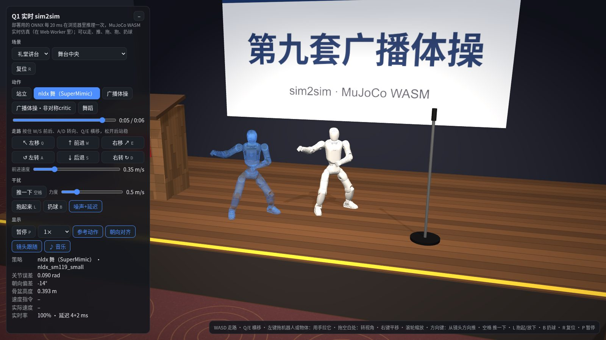
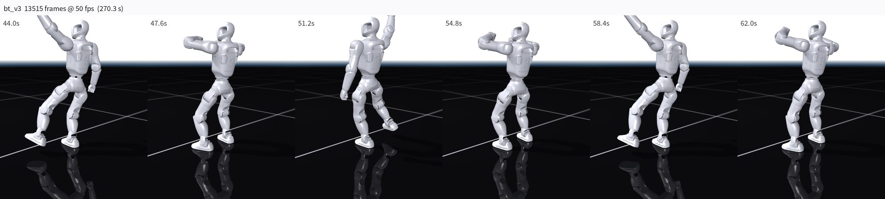
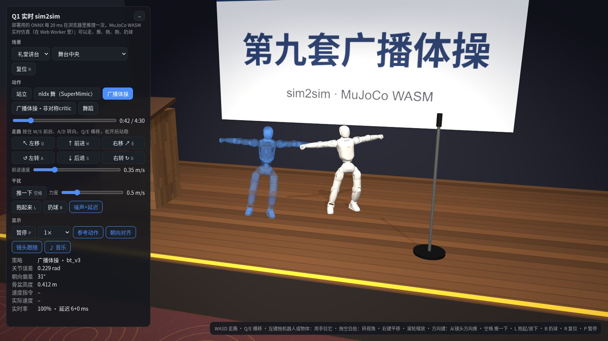
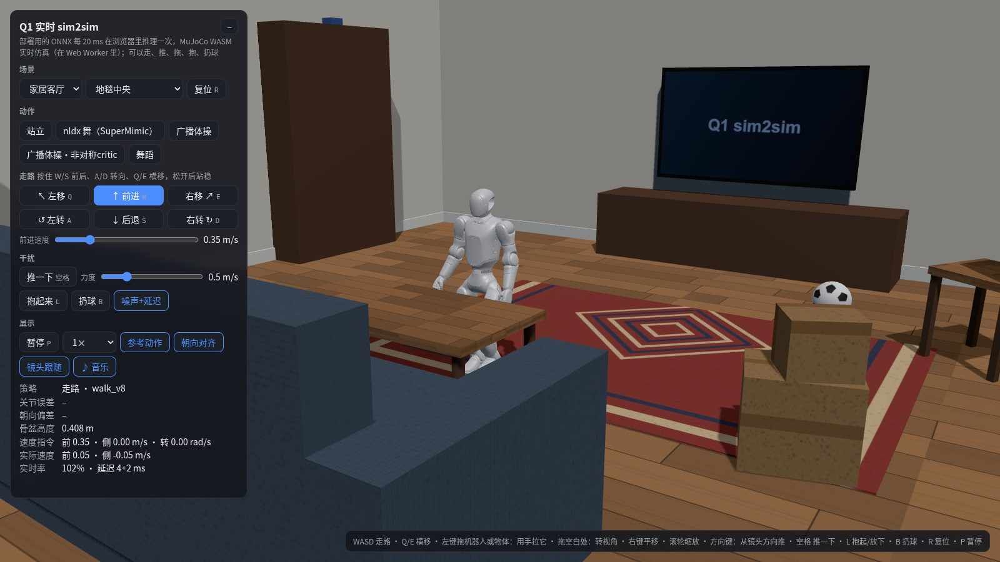
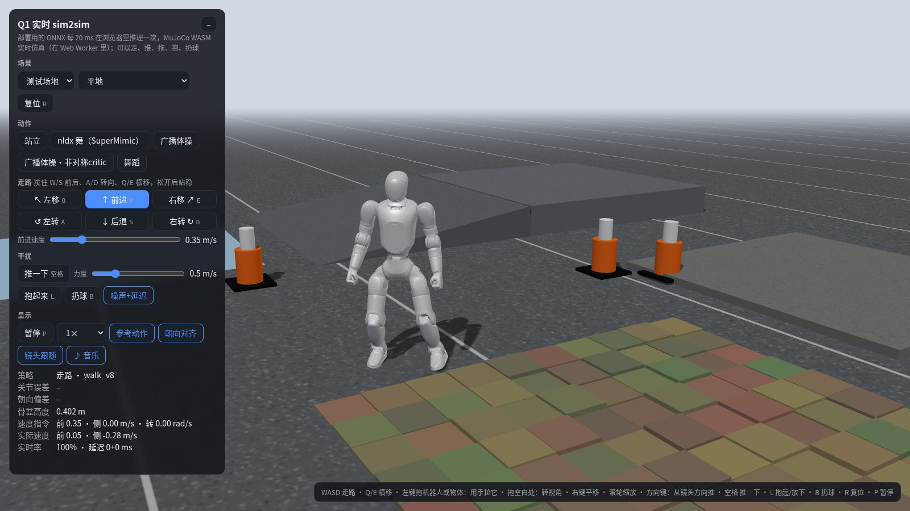

# Q1 Humanoid RL

启元 Q1（22 自由度）人形机器人的强化学习训练与部署代码：MuJoCo 环境、PPO / SAC 训练、ONNX 导出、基于 MuJoCo WASM 的浏览器 sim2sim，以及机器人端的动作注册工具。

<p align="center">
  
</p>

观测布局、关节顺序、PD 增益和默认姿态统一由 `robots/q1/contract/` 定义，训练、导出、浏览器和机器人端都读取这一份定义。导出的动作策略与机器人 `MIMIC_OPENSOURCE_V2` 接口兼容，可以直接注册为自定义动作。

## 结果

动作跟踪，片段 nldx（6.1 s）。评测时域随机化、传感器噪声和延迟全开，64 个环境从第 0 帧开始跑完整段：

| 方法 | 训练（1×A6000） | 摔倒 | 关节 RMSE | 刚体位置误差 | 推扰 0.35 / 0.5 m/s 摔倒 |
|---|---|---|---|---|---|
| PPO | 1.6 h | 0/64 | 0.204 rad | 3.9 cm | 1 / 14 |
| SuperMimic | 2.0 h | 0/64 | 0.077 rad | 2.1 cm | 2 / 8 |
| SuperMimic 蒸馏（512-256-128） | +2.5 min | 0/64 | 0.077 rad | 2.1 cm | 2 / 10 |

蒸馏后的策略已在实机上运行，控制周期 20 ms，0 次超时。

走路，Walk 接口。每 1.5 s 推扰 0.4 m/s，持续 20 s，16 个环境：

| | 速度跟踪 RMS | 摔倒（站立 / 0.4 / 1.0 m/s） | 停步后 3 s 漂移 |
|---|---|---|---|
| 厂商策略 v3.2 | 0.043 | 3 / 1 / 9 | 3.2 cm |
| walk_v8 | 0.048 | 0 / 0 / 1 | 0.5 cm |

walk_v8 在实机上有踝关节横滚的高频抖动。walk_v9 加大动作平滑惩罚后，抖动降到与厂商策略相当，速度跟踪变慢；walk_v9 尚未上机验证。

## 安装

```bash
uv venv --python 3.12
uv pip install "mjlab @ git+https://github.com/mujocolab/mjlab@8bb2bc9e187797689ec82c78c35019afd2fd0376" \
    "warp-lang==1.18.0" pyyaml onnxruntime
bash tools/build_mjbatch.sh .venv/bin/python      # CPU 后端：针对 mujoco 3.16 编译 mjbatch
(cd web && npm install)                           # 浏览器端依赖
make validate                                     # 契约与黄金轨迹检查
```

## 训练

```bash
python train.py --motion squat                                                         # 内置动作，CPU 后端
python train.py --motion npz --npz runs/motions/<clip>.npz --backend warp --envs 8192  # 参考动作跟踪
python train.py --task velocity --backend warp --envs 8192                             # 速度指令走路
python train.py --task walk --backend warp --envs 8192 \
    --env "cpg_law='runtime'" --env clamp_targets=False                                # Walk 接口走路
```

| 任务 | 观测 | 动作 |
|---|---|---|
| `tracking` | 119 维单帧（参考关节位置/速度、参考重力、本体） | 22 |
| `velocity` | 77 维（指令、步态时钟、本体） | 22 |
| `walk` | 71 维 × 5 帧历史，含 CPG 相位 | 13（腿 + 腰横滚） |

`velocity` 的观测是仓库自定的，只用于仿真和浏览器。`walk` 与机器人自带的走路策略同接口。

域随机化：

| 项目 | 范围 |
|---|---|
| 摩擦 | 0.4–1.2 |
| kp / kd | ±15% |
| 连杆质量与惯量 | ±10% |
| 质心 | ±2 cm |
| 编码器零偏 | ±0.02 rad |
| IMU 安装偏差 | 有 |
| 控制延迟 | 0–10 ms |
| 观测延迟 | 0–2 ms |
| 推扰 | 有 |
| 抱起 | 可选 |

PPO 默认使用非对称 critic。`--backend warp` 使用 mujoco_warp，需要 NVIDIA GPU；默认的 mjbatch 运行在 CPU 上。两种后端端到端约为 27k / 34k 步/s，分别对应 32 线程 CPU / A6000。

<p align="center">
  
</p>

参考动作由 `retarget/` 生成，来源包括 G1 动作、BVH / SMPL-X 和单目视频，见 [`retarget/README.md`](retarget/README.md)。

<p align="center"></p>

## sim2sim

```bash
make view RUN=<run> LABEL=<名称>       # 打包到 web/run/ 并启动服务
# http://127.0.0.1:8199/web/sim2sim_view.html?scene=open|room|stage|terrain
```

浏览器在 Web Worker 中运行 MuJoCo WASM（1 ms 步长），每 20 ms 用 onnxruntime-web 推理一次部署 ONNX，噪声和延迟模型与训练一致。界面支持 WASD 走路，以及推、拖、抱起和扔球等干扰。

`tools/rollout_video.py` 在 Python 端做同样的回放并渲染视频。

<table>
<tr>
<td></td>
<td></td>
</tr>
<tr>
<td></td>
<td></td>
</tr>
</table>

## 部署

```bash
python tools/check_vendor_policies.py                        # 用厂商策略校验观测布局
python tools/make_deploy_package.py runs/<run> --name <name> # 生成 onnx / npz / csv
```

机器人端的注册、触发和回滚，SDK v4 固件的限制，以及局域网动作面板，见 [`deploy/robot/README.md`](deploy/robot/README.md)。

机器人的控制核算力有限，上机前用 `tools/distill_policy.py`（DAgger）把大网络蒸馏到约 1 MB。

`check_vendor_policies.py` 需要机器人上的 `cfg/robot/q1_t2d0/`，拷到 `_ref/robot_119/q1_t2d0/`。`make contract` 需要官方模型 `q1_v3.zip`，解压到 `_ref/q1_v3/`。

## SuperMimic

Q1 适配在 [DoyoDia/SuperMimic-Reproduced](https://github.com/DoyoDia/SuperMimic-Reproduced) 的 `q1` 分支，用 `--env.obs-mode mimic` 训练 119 维部署观测。导出和评测用本仓库的工具：

```bash
python tools/export_supermimic.py <ckpt_latest.pt> --motion runs/motions/<clip>.npz -o runs/<name>
python tools/eval_supermimic.py --onnx runs/<name>/policy.onnx --envs 64
python tools/distill_policy.py runs/<name> -o runs/<name>_small
```

## 目录

```
robots/q1/      MJCF（训练 / 浏览器）与部署契约
q1_rl/          环境、后端、PPO / SAC、导出
tools/          导出、评测、蒸馏、渲染、校验
retarget/       参考动作重定向
web/            浏览器 sim2sim
deploy/robot/   机器人端脚本与局域网动作面板
bench/          后端基准
```

## 许可

MIT。`robots/q1/` 中的模型与网格由厂商公开的 Q1 模型转换而来，版权归原厂商所有。本项目为非官方项目，在实机上运行自训策略的风险由使用者自行承担。
