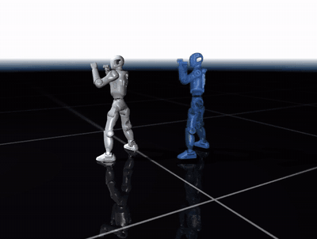
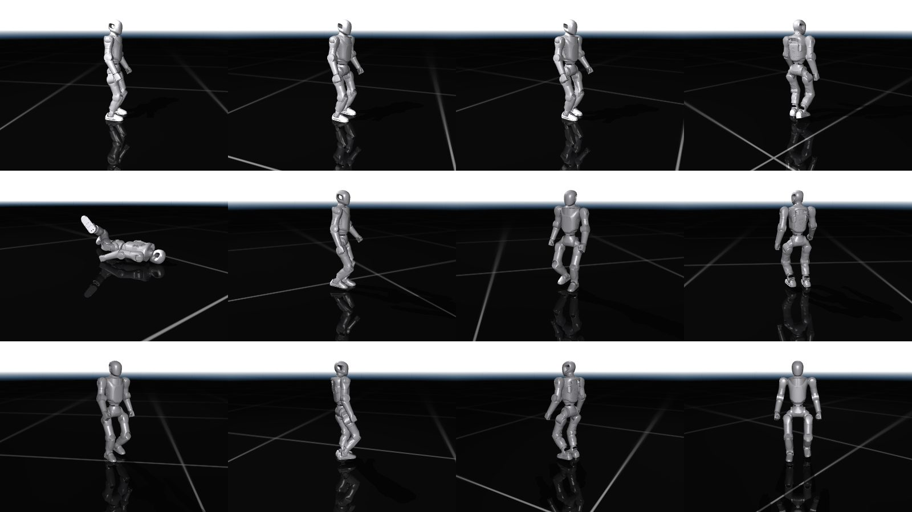

# Q1 Humanoid RL

面向启元 Q1 人形机器人（PrimeBot）的强化学习训练与部署框架。
一套部署契约贯穿训练、浏览器 sim2sim 和真机：在 CPU 或 GPU 上训练，在浏览器里实时验证部署用的 ONNX，再注册成机器人的自定义动作。

<p align="center">
  
</p>

- **部署契约是唯一真源**：观测布局、关节顺序、增益、默认站姿都定义在 `robots/q1/contract/`。训练环境、ONNX 导出、浏览器、机器人共用这一份，由 `make validate` 和黄金轨迹对拍保证一致。
- **任意设备可训练**：默认的 CPU 后端（mjbatch）不需要显卡；有 NVIDIA GPU 时可以切到 mujoco_warp。
- **浏览器实时 sim2sim**：部署用的 ONNX 在 MuJoCo WASM 里每 20 ms 推理一次，可以 WASD 走路，也可以推、拖、抱起机器人，或者扔球。有 4 个场景。
- **动作跟踪、速度指令走路、Walk 接口走路**三类任务，PPO（默认）、SAC、SuperMimic（世界模型 + BPTT）三种算法，外加 DAgger 蒸馏。
- **上机工具链**：打包成机器人的 `MIMIC_OPENSOURCE_V2` 自定义动作，附带局域网网页面板和配乐。

> 本项目是非官方的第三方开源项目，与机器人厂商没有关联。在真机上运行自训策略有损坏机器人和伤人的风险，请先阅读 [`deploy/robot/README.md`](deploy/robot/README.md) 的安全说明，风险自负。

## 效果

**动作跟踪**（nldx，6.1 s 武术组合；在本仓库环境里评测，随机化、噪声、延迟全开，64 台从第 0 帧跑完整段）：

| 方法 | 训练时长（1 × A6000） | 摔倒 | 关节 RMSE | 部位误差 | 推 0.35 / 0.5 m/s 摔倒 |
|---|---|---|---|---|---|
| PPO | 1.6 h | 0/64 | 0.204 rad | 3.9 cm | 1 / 14 |
| SuperMimic（119 维部署观测） | 2.0 h | 0/64 | 0.077 rad | 2.1 cm | 2 / 8 |
| ↳ 蒸馏为 512-256-128（0.9 MB） | +2.5 min | 0/64 | 0.077 rad | 2.1 cm | 2 / 10 |

蒸馏版已上真机：完整跑完整段，推理 0 次超时。

**走路**（Walk 接口，在机器人自带走路策略的 CPG 模型下训练；16 台，每 1.5 s 推 0.4 m/s，持续 20 s）：

| | 速度跟踪 RMS | 站立 / 0.4 / 1.0 m/s 时摔倒 | 停步后 3 s 漂移 |
|---|---|---|---|
| 厂商策略 v3.2（同一环境） | 0.043 | 3 / 1 / 9 | 3.2 cm |
| walk_v8 | 0.048 | 0 / 0 / 1 | 0.5 cm |

walk_v8 在真机上踝关节横滚有高频抖动（仿真里电机跟不上，看不出来）。walk_v9 加大平滑惩罚后，抖动降到厂商的水平（>5 Hz 成分 2.9%，厂商 2.6%），代价是速度跟踪变慢；还没有上真机验证。

## 快速开始

```bash
uv venv --python 3.12
uv pip install "mjlab @ git+https://github.com/mujocolab/mjlab@8bb2bc9e187797689ec82c78c35019afd2fd0376" \
    "warp-lang==1.18.0" pyyaml onnxruntime        # 带入 mujoco / mujoco-warp 3.16、torch、onnx 等
bash tools/build_mjbatch.sh .venv/bin/python      # CPU 后端：对着已装的 mujoco 3.16 编译 mjbatch
(cd web && npm install)                           # 浏览器端：MuJoCo WASM、onnxruntime-web、three.js

make validate                                     # 契约自洽 + 黄金轨迹重放，退出码必须为 0
make train                                        # 默认 squat，2048 环境，约 7–9 分钟
make demo                                         # 打包进 web/，在无头 Chrome 里跑一遍 sim2sim
```

## 浏览器 sim2sim

```bash
python -m http.server 8199          # 在仓库根目录；然后打开 http://127.0.0.1:8199/web/sim2sim_view.html
make view RUN=<run> LABEL=<名字>     # 把训练好的 run 打包进查看器（web/run/）
```

页面不是回放，而是一直在仿真：
- 每 20 ms 用部署 ONNX 推理一次（观测由 `web/contract.js` 构造，与 Python 对拍过），然后跑 20 步 1 ms 的物理。
- 仿真和推理跑在 Web Worker 里，渲染慢不会拖慢仿真。
- 传感器噪声、IMU 安装偏差和控制 / 观测延迟默认开启，与训练时一致。
- 摔倒后切到阻尼保护，和真机一样。

<table>
<tr>
<td></td>
<td></td>
</tr>
<tr>
<td align="center">礼堂讲台：广播体操，蓝色为参考动作</td>
<td align="center">家居客厅：WASD 走路，家具可推倒</td>
</tr>
<tr>
<td></td>
<td></td>
</tr>
<tr>
<td align="center">测试场地：碎石、8° 斜坡、5 cm 路沿、冰面</td>
<td align="center">离线回放（<code>tools/rollout_video.py</code>）</td>
</tr>
</table>

## 训练

```bash
python train.py --motion npz --npz runs/motions/<clip>.npz --backend warp --envs 8192   # 动作跟踪
python train.py --task velocity --backend warp --envs 8192 --iters 1000                 # 速度指令走路（浏览器 WASD）
python train.py --task walk --backend warp --envs 8192 --env "cpg_law='runtime'" \
    --env clamp_targets=False                                                            # Walk 接口走路
python tools/wandb_upload.py runs/<run> [--follow]                                       # 补传或跟随上传 W&B
```

<p align="center">
  
  <br><sub>训练中的并行环境：随机速度指令、域随机化、定时推扰（左中那台被推倒）</sub>
</p>

| 任务 | 观测 / 动作 | 用途 |
|---|---|---|
| `tracking`（默认） | `MIMIC_OPENSOURCE_V2`：119 维单帧 → 22 关节 | 动作跟踪，可直接注册成机器人的自定义动作 |
| `velocity` | 77 维（指令 + 步态时钟 + 本体）→ 22 关节 | 浏览器 WASD 走路。机器人运行时不认识这个布局 |
| `walk` | 71 维 × 5 帧历史 → 13 关节（腿 + 腰横滚） | 机器人自带走路策略的接口；`cpg_law='runtime'` 使用机器人步态时钟的模型 |

**域随机化**（每回合重新采样）：
- 地面摩擦 0.4–1.2；PD 增益 ±15%；各连杆质量和惯量 ×0.9–1.1；骨盆和躯干质心 ±2 cm。
- 编码器零偏 ±0.02 rad；IMU 安装偏差；传感器噪声。
- 0–10 ms 控制延迟、0–2 ms 观测延迟；定时推扰，可选抱起。

**PPO** 默认使用非对称 critic：critic 额外看到特权信息（真实速度、随机化后的物理参数等），导出的策略不受影响。
**SAC** 用 `--algo sac` 开启，需要 GPU learner。在 squat 上 3 个种子都不如 PPO：最终摔倒率 16.8% 对 0%。

**SuperMimic**：Q1 移植版在 [DoyoDia/SuperMimic-Reproduced](https://github.com/DoyoDia/SuperMimic-Reproduced) 的 `q1` 分支。用 `--env.obs-mode mimic` 训练出的策略只看 119 维部署观测，可以直接上机。导出、评测、蒸馏用下面这串命令：

```bash
python tools/export_supermimic.py <ckpt_latest.pt> --motion runs/motions/<clip>.npz -o runs/<name>
python tools/eval_supermimic.py --onnx runs/<name>/policy.onnx --envs 64
python tools/distill_policy.py runs/<name> -o runs/<name>_small --rounds 16   # DAgger 蒸馏成小网络，上机前必做
```

**参考动作**：`retarget/` 把 G1 动作（robot_retargeter）、人体 BVH / SMPL-X（GMR）和视频动捕转到 Q1，并做落脚放平和重心修正。见 [`retarget/README.md`](retarget/README.md)。

<p align="center"></p>

## 后端

| 后端 | 环境数 | 仅环境 | 端到端 PPO |
|---|---:|---:|---:|
| mjbatch（32 线程 CPU） | 2048 | 37.7k 步/s | ~27k 步/s |
| mujoco_warp（RTX A6000） | 8192 | 42.6k 步/s | ~34k 步/s |

默认是 mjbatch，任何机器都能跑；有 NVIDIA GPU 时用 `--backend warp --envs 8192`。两个后端的奖励对拍差 0.01%。基准见 [`bench/results.md`](bench/results.md)。

## 部署契约

sim2real 出问题，多数不是策略的问题，而是观测拼错了：顺序差一位、少乘一个缩放、默认角用错了一套。这类错误不会报错，只会让机器人看起来"学废了"。

`robots/q1/contract/` 是唯一真源，其他地方都从它派生：
- `validate.py` 检查契约自洽。
- `golden_trace.json` 用 100 步 obs→action 对照表检查 Python 和 JS 两套观测构造器（最大差 5.8e-11）。
- `tools/check_vendor_policies.py` 把厂商自己的策略放进本仓库的仿真里跑，确认观测布局与机器人一致。需要先把机器人运控配置目录 `cfg/robot/q1_t2d0/` 只读拷到 `_ref/robot_119/q1_t2d0/`（或用 `--robot-dir` 指定）。

```bash
make contract      # 从模型和配置重新生成全部派生文件（需要把官方的 q1_v3.zip 解压到 _ref/q1_v3/）
make validate      # 之后必须仍然退出码为 0
make web-check     # 在浏览器里重放黄金轨迹
```

两个模型共用这份契约：
- `q1_physics.xml`：训练和部署用，保留 3 个碰撞网格。
- `q1_web.xml`：浏览器用，碰撞网格换成包围盒，没有外部依赖。

细节见 [`robots/q1/contract/README.md`](robots/q1/contract/README.md)。

## 上真机

见 [`deploy/robot/README.md`](deploy/robot/README.md)，内容包括：
- 打包、注册、触发、回滚自定义动作。
- SDK v4 固件的限制。
- 上机前为什么要蒸馏。
- 局域网网页面板。

## 目录

```
robots/q1/          物理模型、浏览器模型、部署契约（contract/）
q1_rl/              环境（tracking / velocity / walk）、后端（mjbatch / warp）、算法（PPO / SAC）、导出
train.py            训练入口
tools/              导出、评测、蒸馏、渲染、各类检查
retarget/           参考动作的重定向与清理
web/                浏览器 sim2sim（MuJoCo WASM + onnxruntime-web）
deploy/robot/       机器人端脚本与局域网网页面板
bench/              后端基准
```

## 许可

[MIT](LICENSE)。`robots/q1/` 里的模型和网格由厂商公开下载的 Q1 模型（`q1_v3`）转换而来，版权归原厂商所有。
